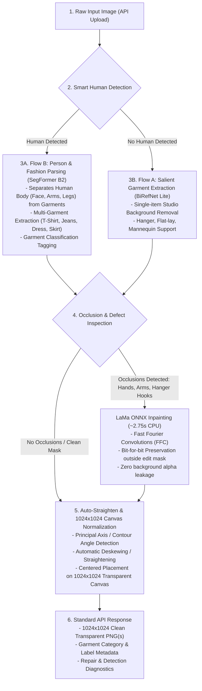

# Arangtik Garment AI — System Requirements & Architecture Specification

## 1. Project Overview

**Arangtik Garment AI** is a unified garment extraction, segmentation, repair, and normalization pipeline. It takes raw fashion images from varied sources (human models, flat lays, mannequins, hangers) and produces catalog-ready, clean, straight, transparent 1024×1024 PNGs with accurate garment classification metadata.

---

## 2. Pipeline Architecture & Execution Flow

The system operates as a unified 5-stage decision-tree pipeline:



---

## 3. API Endpoint Specifications

The service provides **1 Master Unified Smart API** and **3 Modular Sub-APIs**:

### 3.1 Primary API: `POST /api/v1/process-garment` (Master Smart Pipeline)
* **Description:** Automatic end-to-end pipeline. Detects human presence, extracts all or selected garments, repairs occlusions (e.g. hands on pockets, hanger marks), straightens rotation, and returns normalized 1024×1024 transparent PNGs with metadata.
* **Content-Type:** `multipart/form-data`
* **Form Parameters:**
  - `file` (UploadFile, required): Raw input image (`.jpg`, `.jpeg`, `.png`, `.webp`, max 20 MB).
  - `target_garment` (str, optional, default: `"all"`): Garment filter (`"all"`, `"upper_clothes"`, `"pants"`, `"dress"`, `"skirt"`).
  - `auto_repair` (bool, optional, default: `true`): Whether to trigger LaMa fabric inpainting on detected occlusions.
  - `auto_straighten` (bool, optional, default: `true`): Whether to detect angle and straighten tilted garments.
* **Success Response (200 OK):**
```json
{
  "status": "success",
  "mode": "human_worn",
  "human_detected": true,
  "execution_time_s": 5.42,
  "detected_garments_count": 2,
  "garments": [
    {
      "garment_id": "upper_clothes_0",
      "category": "upper_clothes",
      "recognized_label": "T-Shirt",
      "rotation_angle_deg": -2.4,
      "repaired": true,
      "repair_method": "lama_ffc_onnx",
      "image_dimensions": [1024, 1024],
      "output_png_url": "/api/v1/outputs/uuid_upper_clothes.png"
    },
    {
      "garment_id": "pants_1",
      "category": "pants",
      "recognized_label": "Jeans / Trousers",
      "rotation_angle_deg": 1.1,
      "repaired": true,
      "repair_method": "lama_ffc_onnx",
      "image_dimensions": [1024, 1024],
      "output_png_url": "/api/v1/outputs/uuid_pants.png"
    }
  ]
}
```

### 3.2 Modular Sub-APIs
| Method | Endpoint | Purpose | Typical Use Case |
| :--- | :--- | :--- | :--- |
| `POST` | `/api/v1/extract-isolated` | Fast salient background removal (Flow A: BiRefNet) | Flat-lay shoots, hanger photos, clean studio displays |
| `POST` | `/api/v1/extract-worn` | Semantic fashion parsing (Flow B: SegFormer B2) | Model photos where specific garment extraction is requested |
| `POST` | `/api/v1/repair-garment` | Fast Fourier inpainting (LaMa ONNX) | Repairing pre-existing cutouts with manual or auto masks |
| `GET` | `/health` | Service and model readiness status | Deployment checks, model loading, RAM usage telemetry |

---

## 4. Hardware & Runtime Specifications

| Component | Minimum Specification | Recommended Specification |
| :--- | :--- | :--- |
| **Operating System** | Windows 10/11, Ubuntu 22.04 LTS | Windows 11 / Linux x86_64 |
| **Python Version** | Python 3.10 – 3.12 (Verified: 3.12.15) | Python 3.12 |
| **CPU Architecture** | 4-Core x86_64 | 6+ Core Intel / AMD x86_64 |
| **RAM (System)** | 8 GB | 16 GB (Peak execution consumes ~2.4 GB) |
| **Storage** | 5 GB free disk space (models + venv) | 10 GB SSD |
| **Inference Mode** | CPU Execution Provider (No GPU required) | CPU Execution Provider |

---

## 5. Pretrained AI Models Specification

| Model Role | Pretrained Model ID | Framework | Checkpoint Size | Target Output |
| :--- | :--- | :--- | :--- | :--- |
| **Flow A: Salient BG Removal** | `birefnet-general-lite` | ONNX / rembg | ~120 MB | Transparent foreground cutout |
| **Flow B: Fashion Parsing** | `mattmdjaga/segformer_b2_clothes` | PyTorch / Transformers | ~100 MB | 18-class ATR semantic segmentation map |
| **Shared Fabric Inpainter** | `opencv/inpainting_lama` | ONNX Runtime | 88.3 MB | Seamless fabric reconstruction (FFC ResNet) |

---

## 6. Supported Garment Recognition Categories

SegFormer B2 Clothes ATR Taxonomy mapping:

| ATR Class ID | Canonical Label | Recognized Garment Category | Handled In Pipeline |
| :--- | :--- | :--- | :--- |
| `4` | `Upper-clothes` | T-Shirt, Shirt, Kurti, Blouse, Jacket | Yes (Separated / Extracted) |
| `5` | `Skirt` | Lehenga skirt, flared skirt, midi skirt | Yes (Separated / Extracted) |
| `6` | `Pants` | Jeans, Trousers, Chinos, Leggings | Yes (Separated / Extracted) |
| `7` | `Dress` | Gown, Anarkali, One-piece dress | Yes (Separated / Extracted) |
| `14, 15` | `Left-arm, Right-arm` | Human Body Anatomy | Filtered out / Used for occlusion mask |
| `11, 12, 13`| `Face, Left-leg, Right-leg`| Human Body Anatomy | Filtered out / Human presence detection |

---

POST /api/v1/process-garment (Master Smart Endpoint)
POST /api/v1/extract-worn (Human model se specific garment nikalne ke liye)
POST /api/v1/extract-isolated (Flat-lay / Hanger ke liye direct background removal)
POST /api/v1/repair-garment (Dedicated LaMa fabric inpainting)
GET /health (Model readiness aur RAM telemetry)

## 7. Unified Python Package Dependencies

All dependencies are consolidated in `requirements.txt`:
* **Web Framework:** FastAPI, Uvicorn, Python-Multipart, Pydantic, Python-Dotenv
* **Image & Vision:** Pillow, NumPy, SciPy, OpenCV-Python-Headless
* **AI & Machine Learning (CPU):** PyTorch CPU (2.3.1), TorchVision CPU (0.18.1), Transformers (4.44.2), ONNXRuntime, Rembg CPU
* **System Telemetry:** Psutil

---

## 8. Installation & Setup Guide

```powershell
# 1. Create a clean virtual environment
python -m venv .venv-unified

# 2. Activate virtual environment (Windows PowerShell)
.\.venv-unified\Scripts\Activate.ps1

# 3. Upgrade pip tooling
python -m pip install --upgrade pip setuptools wheel

# 4. Install consolidated requirements
pip install -r requirements.txt

# 5. Run API Server
uvicorn app.main:app --host 0.0.0.0 --port 8000 --reload
```

